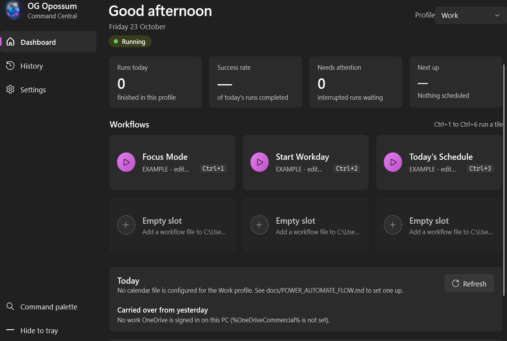
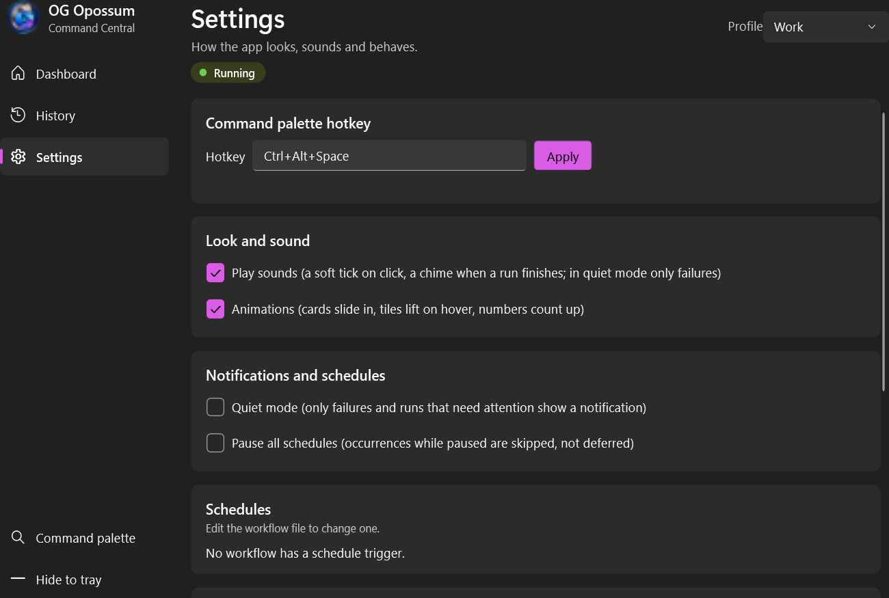
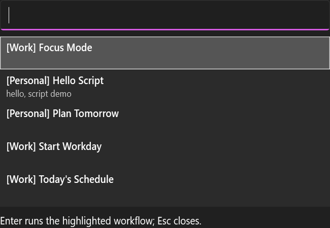

# OG Opossum Command Central

[](https://github.com/DanielMinton/IgniteMeDammit/actions/workflows/ci.yml)


A Windows tray app that runs my repeatable routines (open these apps, these pages, this checklist,
this script) with one click or one hotkey, remembers every run, and talks to Microsoft 365 without
ever signing in to anything.

It runs on a locked-down work laptop as a **standard user**: no admin, no services, no network
listeners, no telemetry, no app registration, no policy workarounds. Those weren't nice-to-haves.
They were the whole damn brief.



## Why this exists

Every workday starts with the same routine: open Outlook, open Teams, open the sites I live in, check
what's on the calendar, remember what I left hanging yesterday. It ends with the reverse. Doing
that by hand every day is the kind of tedium that makes you want to automate something out of spite.

But the machine it has to run on is a managed work PC where I'm a standard user. So I wrote a spec
for the tool I actually wanted, then built it inside the rules of that machine instead of pretending
they don't exist.

## What it does

- **Workflows as JSON**: one file per routine, per profile, hand-editable and diffable
  ([schema](docs/WORKFLOW-SCHEMA.md)). Steps can depend on each other, run in parallel (bounded),
  lock shared resources, time out, and cancel cleanly. Cancel kills the whole process tree it
  launched, not just the parent.
- **Work and Personal profiles that can't leak into each other.** That's enforced in the engine
  with per-profile action allowlists, not by hiding a button. The Personal profile can't read the
  work calendar, period.
- **A scheduler that handles time properly**: explicit time zones, DST, missed-run policies,
  duplicate suppression, reconciliation at startup.
- **Crash recovery that knows what it doesn't know.** After a crash it resumes only steps that are
  provably safe to repeat, and asks you about the rest instead of guessing.
- **Durable history in SQLite**, with secrets scrubbed before anything is stored. Tokens, connection
  strings, `password=`, `--token x`, URL user info. There are tests for each shape.
- **A tray app that doesn't look like 2009 WinForms**: Fluent theme (Mica on Windows 11), live
  progress, a command palette on **Ctrl+Alt+Space**, Ctrl+1 to Ctrl+6 for the tiles, subtle motion,
  and synthesized sound cues. All of it respects Windows "Animation effects", high contrast and text
  scaling. Narrator reads what matters.
- **Microsoft 365 without the network.** See below. This is the part I'm proudest of.

<table>
<tr>
<td></td>
<td></td>
</tr>
</table>

## The Microsoft 365 part (or: how to integrate without an app registration)

The "proper" way to read my calendar from a desktop app is a Graph app registration plus admin
consent. I don't have admin consent at work, and I'm not going to ask IT to approve a side project
so I can save twelve clicks. So the app never touches the network. It talks to Microsoft 365
through **files in my work OneDrive**, and my own Power Automate flows do the cloud half with
standard connectors I'm already allowed to use:

```
 Outlook / Teams / SharePoint                      this PC
 ┌──────────────────────────┐   OneDrive sync   ┌─────────────────────────────┐
 │ Power Automate flows     │ ───────────────▶  │ calendar.json, tomorrow.json│──▶ app reads
 │ (run as me, standard     │                   │                             │
 │  connectors only)        │ ◀───────────────  │ status.json, outbox/*.json  │◀── app writes
 └──────────────────────────┘                   └─────────────────────────────┘
```

- **Calendar feed**: a flow writes the rest of today's events to `calendar.json` every 15 minutes.
  The dashboard's Today panel reads it. If the file is missing, stale or half-synced, the panel
  says so instead of crashing.
- **status.json**: a scrubbed summary (needs attention, failures in the last 24 h, what's running).
  The morning briefing flow reads it.
- **Alert outbox**: when a run fails, the app drops a small file in `outbox\`. A flow posts it to
  Teams and deletes it. It's a webhook made of files, because the no-network rule says so.
- **Carryovers**: a 4:30 pm flow writes `tomorrow.json`, and tomorrow's Today panel shows it.

Everything for the cloud side is in [`cloud/`](cloud): seven flow definitions, three SharePoint
lists, and a Hub page. They're checked against the app's own file contracts by
`CloudContractTests`, so if the app's JSON shape changes and a flow doesn't, the build fails.
Click-by-click setup is in [docs/POWER_AUTOMATE_FLOW.md](docs/POWER_AUTOMATE_FLOW.md).

Is it a bit ridiculous to build a message bus out of OneDrive? Sure. But it works with New Outlook,
needs zero admin consent, survives being offline, and every hop is a file I can open and read.
I'll take boring and inspectable over clever and blocked.

## How this got built

I'll be straight about this, because you'd figure it out in thirty seconds anyway: **I didn't
hand-type these 20,000 lines. I wrote the spec and the harness, and Claude Code did the typing.**

The interesting engineering is in how that was controlled:

- **[docs/ARCHITECTURE.md](docs/ARCHITECTURE.md)** is the spec I wrote first. It's deliberately
  bigger than what got built.
- **[build.sh](build.sh)** runs the build in eight phases (preflight, feasibility spike, scaffold,
  core loop, reliability, calendar, hardening, release). Each phase is one headless Claude Code
  session with a fixed set of guardrails appended to its system prompt: standard user only, no
  sign-ins, no connectors, no network, nothing written outside the repo, stop and write
  `BLOCKED.md` instead of working around policy.
- **The script doesn't trust the model.** After every session it runs its own gate: build with
  warnings as errors, the full test suite, and two headless smoke runs against a scratch data
  folder. A phase only counts when the gate passes. Failed gates get a couple of repair attempts,
  then it stops. Every passed phase is a tagged commit I can roll back to.
- **Every meaningful call is written down** in [docs/DECISIONS.md](docs/DECISIONS.md): 50-odd
  ADRs, each with what was decided, why, and what would make me change my mind.
- **[docs/ACCEPTANCE.md](docs/ACCEPTANCE.md)** maps every acceptance criterion in the spec to a
  named test, a manual check, or an honest "deferred, and here's why".

The AI writes fast. What it doesn't do on its own is know where the walls are, which shortcuts get
you banned from a managed PC, or when "it compiles" isn't the same as "it's right". That part's on
me, and that's the part I want you to judge.

## Where to look if you're reviewing this

| If you care about | Start here |
|---|---|
| Architecture and trade-offs | [docs/DECISIONS.md](docs/DECISIONS.md), then [docs/ARCHITECTURE.md](docs/ARCHITECTURE.md) |
| The engine (DAG, parallelism, locks, cancellation) | `src/OG_opossum_command.Core/Engine/` |
| Scheduling, time zones, DST | `src/OG_opossum_command.Core/Scheduling/` |
| Crash recovery | `src/OG_opossum_command.Core/Recovery/` |
| Secret redaction | `src/OG_opossum_command.Core/History/OutputRedactor.cs` and its tests |
| Microsoft 365 integration | [`cloud/`](cloud), `src/OG_opossum_command.Core/Exports/`, `Calendar/` |
| WPF, MVVM, accessibility, motion | `src/OG_opossum_command.Desktop/` (`Accessibility/Motion.cs` is the fun one) |
| Proof it holds together | `tests/` (469 tests), [CI](.github/workflows/ci.yml) |
| How AI was kept on a leash | [build.sh](build.sh), the `GUARDRAILS` block |

## Stack

- **.NET 10** (LTS), C# latest, nullable on, analyzers at `latest-recommended`, warnings are errors.
- **WPF** with the built-in Fluent theme (`ThemeMode=System`), **CommunityToolkit.Mvvm**,
  **H.NotifyIcon.Wpf** for the tray.
- **SQLite** via Microsoft.Data.Sqlite, with versioned migrations.
- **xUnit** for tests. Three runtime dependencies in total, and each one had to justify itself.
- **Power Automate + SharePoint + OneDrive** for the Microsoft 365 side, standard connectors only.

No MSIX, no installer framework, no services. It's a per-user, self-contained `win-x64` publish that
installs into `%LOCALAPPDATA%\Programs` and keeps the previous version around for rollback.

## Build, test, run

You need Windows 10/11 and the .NET 10 SDK (a per-user install under
`%LOCALAPPDATA%\Microsoft\dotnet` is enough). From the repo root:

```bash
dotnet build OG_opossum_command.slnx -warnaserror
dotnet test  OG_opossum_command.slnx
dotnet run --project src/OG_opossum_command.Desktop
```

Two headless self-checks. They never show a window, open anything real, grab the hotkey or touch
your real data folder, and they exit on their own:

```bash
exe=src/OG_opossum_command.Desktop/bin/Debug/net10.0-windows/OG_opossum_command.exe
"$exe" --smoke-test   # paths, DB migration, profiles, examples, one engine run with fakes → SMOKE OK
"$exe" --smoke-ui     # real App start-up, off-screen window, every page bound, tray icon → SMOKE-UI OK
```

It's a windowed exe, so output only shows if you capture it (`out=$("$exe" --smoke-test)`). The
exit code is the contract. Without `OGOC_DATA_DIR` the smoke modes use a throwaway folder in `%TEMP%`.

## Using it

Workflows live in your profile folder (examples get copied there on first run, marked
`EXAMPLE - edit me`). Six actions so far: open a web page, open a folder, launch a program with an
argument array, run a trusted script, read the calendar file, show today's schedule.

Scripts are deliberately fenced in. `windows.script.run` only runs files from
`profiles\<Work|Personal>\scripts`, with an explicit interpreter (`powershell` or `cmd`) and an
argument array. If PowerShell's execution policy blocks a `.ps1`, the step tells you so, and the
app never overrides that policy. `windows.process.launch` refuses shells and script hosts outright,
so nobody gets to sneak `cmd /c` through the side door.

Closing the window hides it to the tray. Quit is in the tray menu. Launching it a second time just
brings the first one forward.

### Where data lives

Every per-user path comes from one `AppPaths` service in Core:

| Situation | Data root |
|---|---|
| Normal use | `%LOCALAPPDATA%\OG_opossum_command` |
| `OGOC_DATA_DIR` set (tests, build script, experiments) | that folder; it must be absolute |

| Under the root | What |
|---|---|
| `data.db` (+ `-wal`, `-shm`) | SQLite: profiles, workflow versions, schedules, executions, step states, redacted events, settings, migrations |
| `profiles\<Work\|Personal>\workflows\*.json` | That profile's workflows. A file's `profileId` must match its folder. |
| `profiles\<Work\|Personal>\scripts\` | The only place scripts run from |
| `profiles\<Work\|Personal>\profile.json` | Optional: `allowedActions`, `calendarFile`, `exports` |
| `logs\crash.log`, `logs\exports.log` | Startup failures and export state changes |

The app never reads or writes relative to the current directory and never touches the registry.
Outside the data root it only uses the profile's exports folder (by default
`%OneDriveCommercial%\OG_opossum_command` for Work, none for Personal). It reads `calendar.json` and
`tomorrow.json`, writes only `status.json`, `outbox\*.json` and short-lived temp files, and never
creates a OneDrive root.

## Repo layout

| Path | What |
|---|---|
| `src/OG_opossum_command.Core` | Engine, workflows, actions, scheduling, history, profiles, exports. Plain `net10.0`, no UI. |
| `src/OG_opossum_command.Desktop` | WPF tray app (`net10.0-windows`), builds `OG_opossum_command.exe` |
| `tests/OG_opossum_command.Core.Tests` | xUnit tests, including contract tests for the cloud files and XAML rules |
| `cloud/` | Power Automate flows, SharePoint lists, the Hub |
| `examples/` | Example workflows and a trusted example script |
| `docs/` | Spec, decisions, acceptance matrix, schema, flow guide |
| `spikes/feasibility` | The throwaway day-one spike that proved this could run on a locked-down PC |
| `tools/IconBuilder` | Builds the multi-size `.ico` from the source artwork |
| `build.sh` | The phased, gated build harness |

## Status

Version 0.3.0, installed per-user on my own machine. What's next is in [CHANGELOG.md](CHANGELOG.md) and the
deferred rows of [docs/ACCEPTANCE.md](docs/ACCEPTANCE.md). The code name `OG_opossum_command` is in
every namespace because it's a fixed name, and yes, I made the analyzers put up with the underscore
(ADR-018 explains how, and it's a weirdly satisfying read if you like Roslyn trivia).

## About me

I'm Daniel Minton. I build things that make work less tedious, inside whatever rules the
environment imposes. I'd love to do this at a bigger scale, and I'm trying to get to
**Microsoft Ignite**. If something in here made you think, or made you wince, open a
[discussion](../../discussions) or an issue. I read them.

All rights reserved; see [LICENSE](LICENSE). Read it, run it, judge it. Ask before you reuse it.
