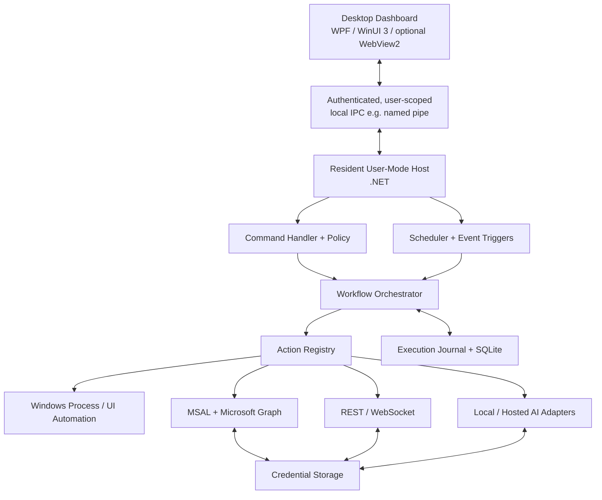
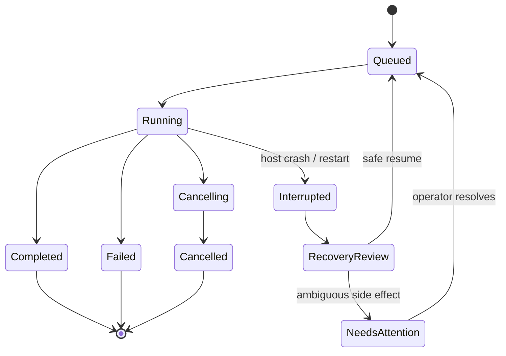
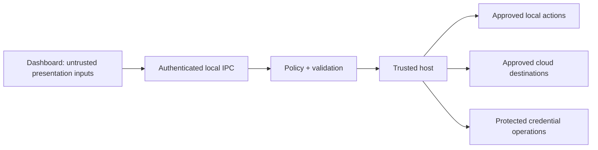

# ⛧ OPOSSUM CONTROL ⛧

> [!NOTE]
> **Read this first.** This is the spec I wrote before building anything. It's deliberately bigger than what
> got built: a separate host process, Graph sign-in, AI planning, remote control. I wanted the whole shape on
> paper so I'd know which seams to keep while I cut features. "OPOSSUM CONTROL" is the old name; the app
> shipped as OG Opossum Command Central (code name `OG_opossum_command`). Where the build went a different
> way, and why, is in [docs/DECISIONS.md](DECISIONS.md). This is the plan, not the receipt.

> **A Windows-first cognitive-support command center**  
> **Architecture & Engineering Specification · Draft v0.1 · 22 October 2026**  
> *Less friction. Fewer decisions. Reliable execution.*

---

> [!IMPORTANT]
> **Design principle:** OPOSSUM CONTROL is a personal tool to cut executive-function load, context switching, repetitive work, and operational uncertainty. It is **not** a generic AI agent that improvises unrestricted actions. Reliability, comprehensibility, privacy, and low-friction interaction outrank feature count.

## Document status

| Field | Value |
|:--|:--|
| Project | OPOSSUM CONTROL |
| Status | Architecture proposal — not implemented |
| Primary platform | Windows 11, standard-user context |
| Primary audience | Me; maybe a rollout at work later |
| Proposed core | C# / supported .NET LTS, background user-mode host |
| User interface | WPF or WinUI 3; React/WebView2 still possible |
| Local persistence | SQLite; protected secrets in Windows-backed storage |
| Integration targets | Windows, Microsoft 365, generic REST/WebSocket, optional AI |
| Governing constraint | Organizational security policies must be respected |

## Contents

1. [Mission, user outcomes, and operating philosophy](#01--mission-user-outcomes-and-operating-philosophy)
2. [Scope and requirements](#02--scope-and-requirements)
3. [Architecture at a glance](#03--architecture-at-a-glance)
4. [Why Windows-first and why not a browser-only app](#04--why-windows-first-and-why-not-a-browser-only-app)
5. [Component responsibilities](#05--component-responsibilities)
6. [Execution lifecycle and concurrency](#06--execution-lifecycle-and-concurrency)
7. [Action model and workflow format](#07--action-model-and-workflow-format)
8. [Scheduling, triggers, and session semantics](#08--scheduling-triggers-and-session-semantics)
9. [Windows process and UI automation](#09--windows-process-and-ui-automation)
10. [Microsoft 365 and external integration](#10--microsoft-365-and-external-integration)
11. [AI integration without surrendering control](#11--ai-integration-without-surrendering-control)
12. [Security and data separation](#12--security-and-data-separation)
13. [Persistence, crash recovery, and observability](#13--persistence-crash-recovery-and-observability)
14. [Interface and accessibility principles](#14--interface-and-accessibility-principles)
15. [Packaging, updates, and organization deployment](#15--packaging-updates-and-organization-deployment)
16. [Trade-offs and architectural decision records](#16--trade-offs-and-architectural-decision-records)
17. [Implementation roadmap](#17--implementation-roadmap)
18. [Acceptance tests and definition of done](#18--acceptance-tests-and-definition-of-done)
19. [Risks, mitigations, and deferred features](#19--risks-mitigations-and-deferred-features)
20. [Repository and project conventions](#20--repository-and-project-conventions)
21. [Open engineering decisions](#21--open-engineering-decisions)

---

# 01 · Mission, user outcomes, and operating philosophy

**Problem:** Repetitive workflows and context shifts impose a disproportionate cognitive cost. I shouldn't have to rebuild the same sequence of windows, clicks, context, and decisions over and over.

**Solution:** A programmable Windows command center that maps small, intentional interactions to safe, observable, reversible-where-possible workflows. The interface should offer a compact, stable surface; the execution engine should perform the actual work.

**Success is behavioral, not cosmetic.** Measure:

- Number of interactions removed per common workflow.
- Time from intention to completed task.
- Frequency and duration of context switches.
- Failures requiring manual recovery.
- How sure I am about *what ran, what changed, and what remains*.
- Accessibility and predictability under distraction, overload, or interrupted attention.

### Product invariants

1. **Local-first:** offline-capable actions must function without cloud access.
2. **Least privilege:** no elevation, security-policy bypass, or unrestricted command channel by default.
3. **Deterministic first:** AI may recommend plans; only the validated execution engine runs approved actions.
4. **State is durable:** critical execution transitions are persisted.
5. **UI is replaceable:** no process control or scheduling logic belongs in button event handlers.
6. **Failures are legible:** explain success, failure, partial completion, and indeterminate outcomes.
7. **Organizational data is bounded:** workplace secrets and client information must never silently enter personal profiles or AI services.
8. **Simple until proven insufficient:** avoid servers, brokers, plugin marketplaces, distributed queues, or cross-platform abstraction layers without a concrete requirement.

---

# 02 · Scope and requirements

## Functional capabilities

| Domain | Requirement | Architectural implication |
|:--|:--|:--|
| Local execution | Launch applications, scripts, and CLI tools | Process adapter with argument arrays, stdout/stderr, exit status, and termination policy |
| Application control | Interact with existing Windows applications | Win32/UI Automation adapter; interactive session limitations |
| Persistence | Keep workflows running when dashboard exits | Independently running **per-user host** if exit means actual process termination |
| Triggers | Manual, scheduled, and event-driven | Durable schedule store; explicit missed-run policy |
| Parallelism | Concurrent tasks and cancellation | Bounded concurrency, cancellation propagation, resource locks |
| Microsoft | Connect to permitted M365 resources | MSAL.NET, Microsoft Graph, tenant consent validation |
| Network | REST and WebSocket clients | Reusable adapters; authentication and timeouts |
| AI | Local and remote models | Provider-neutral contract with approval gates |
| Customization | Profiles, buttons, grids, colors | Data-driven presentation schema |
| Feedback | Streaming output and history | Structured events plus persisted execution journal |
| Remote control | Optional mobile/browser client | Explicit opt-in gateway; separately modeled trust boundary |
| Deployment | Standard-user operation where permitted | Per-user distribution; early policy testing |
| Offline | Local actions work without internet | No mandatory server, license ping, or hosted database |
| Security | Protected secrets and work/personal separation | Separate profiles, credential boundaries, action policies |
| Recovery | Interrupted/partially completed workflows | Checkpoints, uncertain-state handling, idempotency metadata |
| Releases | Package, upgrade, distribute | Versioned artifacts, schema migrations, signed release path |

## Explicit non-goals for v1

- Autonomous execution of AI-generated arbitrary PowerShell commands.
- Controlling locked, logged-out, or sleeping Windows desktop sessions as though they were interactive.
- Bypassing employer endpoint security or consent policy.
- Unrestricted remote process-launch API.
- Cloud-first workflow hosting, team administration, multi-tenant SaaS.
- Cross-platform Windows/macOS/Linux feature parity.
- Visual DAG editor, arbitrary third-party plugin marketplace, agent swarms.

---

# 03 · Architecture at a glance



**Logical architecture:** Presentation → application commands → workflow engine → registered action adapters → operating system or network. **Physical architecture for persistent execution:** normally two user-mode processes (dashboard and resident host), sharing no in-memory state and communicating over constrained local IPC.

If merely *hiding* the dashboard is acceptable, a **single tray-resident process** is a simpler feasible v1. The final process split depends on the precise meaning of “dashboard closed”; this is a decision gate, not a foregone conclusion.

### Example command path

```text
Click START WORKDAY
   ↓
Desktop submits RunWorkflow(workflowId, profileId)
   ↓
Host authenticates IPC peer and validates profile/action policy
   ↓
Host records execution ID and selects eligible steps
   ↓
Actions execute with bounded concurrency and cancellation
   ↓
State transitions and redacted output stream to journal
   ↓
Dashboard displays progress; can disconnect and reconnect
```

---

# 04 · Why Windows-first and why not a browser-only app

Browser JavaScript is generally sandboxed and cannot directly run arbitrary local Windows executables, inspect processes, or control desktop windows. An authenticated **web portal** can orchestrate local work **only if a locally installed component acts on its requests**. That component may communicate via loopback HTTP, WebSocket, native messaging, or an application-specific IPC channel.

For a single Windows workstation, a native host minimizes unnecessary network-exposed surfaces. A React interface can still be used *inside a desktop executable* through WebView2; it does not require public web hosting or a local REST server.

| Approach | Strength | Trade-off | Assessment |
|:--|:--|:--|:--|
| WPF + .NET | Mature data binding, established controls, Windows integration | Windows-only XAML UI | Strong candidate |
| WinUI 3 + .NET | Modern Windows App SDK controls and design system | Runtime/packaging complexity; control ecosystem trade-offs | Strong candidate |
| .NET + WebView2 + React | Web UI flexibility with direct Windows host | Web/frontend toolchain and IPC bridge | Choose when sophisticated UI warrants it |
| Tauri + React + Rust | Cross-platform desktop shell and capability model | Another native language/toolchain; Windows-specific integration still needed | Valuable if cross-platform becomes real |
| Electron | Broad web ecosystem | Bundled Chromium/Node footprint; more lifecycle/security care | Not necessary for current scope |
| Browser + local agent | Multiple clients, flexible deployment | Authenticated agent protocol, listener/remote security, network complexity | Defer unless mobile control becomes central |

**No framework has a monopoly on launching user-permitted Windows processes.** The governing constraints are Windows identity, session, security policies, and the quality of the execution engine. UI customization is primarily an engineering-effort question, not a fundamental WinUI limitation.

---

# 05 · Component responsibilities

### A. Dashboard (presentation)

- Render tiles, profiles, search, recent executions, notifications, and configuration.
- Submit typed commands: `RunWorkflow`, `CancelExecution`, `PauseScheduler`, `UpdateProfile`.
- Subscribe to live status events and reconstruct the current view from durable state after reconnect.
- **Must not** own active workflow tasks, secrets, or scheduling authority.

### B. Resident host (application boundary)

- Own the workflow lifecycle, user-session startup, shutdown, resource budgets, and error boundaries.
- Provide local IPC commands with an allowlist and user-scoped access checks.
- Expose read-only health and execution-status queries to the UI.
- Enforce one authoritative instance per Windows user/profile, with explicit lock ownership.

### C. Workflow orchestrator

- Load and validate schema-versioned workflow definitions.
- Resolve step dependencies and registered action implementations.
- Apply timeouts, retries, locks, cancellations, and continuation policies.
- Record transitions durably, including uncertain outcomes.

### D. Action adapters

An adapter has a **stable identifier**, a typed input schema, declared permissions, output schema, timeout defaults, and an idempotency classification. Examples: `windows.process.launch`, `windows.window.focus`, `m365.calendar.list`, `http.request`, `ai.generate`.

### E. Persistence and secrets

- SQLite: profiles, workflow definitions, schedules, executions, step states, and redacted logs.
- Dedicated credential protection: MSAL token-cache integration, Windows credential storage/DPAPI where appropriate.
- Keep credentials **out of** workflow definitions, SQLite plaintext fields, crash dumps where feasible, and support bundles.

---

# 06 · Execution lifecycle and concurrency

## Workflow state machine



Persist transitions before acknowledging commands where durability matters. Do not confuse an in-memory `CancellationToken` with termination of an external executable. For subprocesses, track process handles, enforce timeouts, and implement process-tree cleanup when supported; Windows job objects may be useful for stricter child-process containment, subject to technical constraints.

### Concurrency policy

- **Global limit:** configurable number of simultaneous workflows.
- **Per-action limit:** for expensive or rate-limited adapters.
- **Resource locks:** e.g., exclusive access to a specific desktop window, file, or document.
- **Queue semantics:** deduplicate repeated button presses by configurable workflow policy.
- **Structured cancellation:** cancellation should reach child tasks and terminate/abandon external work according to adapter contracts.
- **UI Automation serialization:** most interactive desktop control should be serialized for the relevant target window/session.

### Retry classification

| Action class | Retry posture |
|:--|:--|
| Read-only API GET | Usually retryable with backoff and limits |
| Create/update remote resource | Retry only with documented idempotency/reconciliation |
| Send mail / post message | Treat as potentially non-idempotent; reconcile before retry |
| Launch local process | Avoid blind repeat; check process/task outcome |
| File overwrite | Prefer atomic write/rename, backups or versioning |
| UI click automation | Highly contextual; do not blindly replay after ambiguous result |

---

# 07 · Action model and workflow format

Keep workflows declarative. **The example below is a proposed schema, not a final implementation contract.**

```json
{
  "schemaVersion": 1,
  "id": "start-workday",
  "name": "Start Workday",
  "profileId": "work",
  "trigger": { "type": "manual" },
  "execution": { "maxParallelSteps": 2, "onDuplicate": "focus-existing" },
  "steps": [
    {
      "id": "calendar",
      "action": "m365.calendar.list",
      "inputs": { "timeRange": "today" },
      "timeoutSeconds": 20,
      "retry": { "maxAttempts": 2, "mode": "safe-only" }
    },
    {
      "id": "outlook",
      "action": "windows.url.open",
      "inputs": { "url": "https://outlook.office.com/" },
      "timeoutSeconds": 15
    },
    {
      "id": "display",
      "action": "dashboard.schedule.show",
      "dependsOn": ["calendar"],
      "inputs": { "eventsFromStep": "calendar" },
      "onFailure": "notify-and-continue"
    }
  ]
}
```

**Avoid implicit string interpolation into shell commands.** Pass executable paths and argument arrays as structured values, validate allowed targets, and distinguish trusted explicitly authored scripts from untrusted content. A future workflow editor can operate on the same schema without controlling how the engine executes it.

### Representative .NET interface (illustrative)

```csharp
public interface IWorkflowAction
{
    string Type { get; }
    Task<ActionResult> ExecuteAsync(
        ActionContext context,
        CancellationToken cancellationToken);
}

public sealed record ActionResult(
    bool Succeeded,
    string? ErrorCode,
    IReadOnlyDictionary<string, object?> Outputs);
```

Production versions should use versioned and strongly validated input/output DTOs rather than arbitrary dictionaries at security boundaries.

---

# 08 · Scheduling, triggers, and session semantics

### Supported trigger families

1. Manual tile / command palette / keyboard shortcut.
2. Cron-like or calendar schedule persisted in SQLite.
3. Local events (approved file watcher, process availability, user-session events).
4. Microsoft 365 events (polling or approved subscription mechanisms).
5. Remote or mobile invocation (**future opt-in**).

Every scheduled workflow needs an explicit **time zone**, daylight-saving behavior, missed-run policy (`skip`, `run-once`, `catch-up-limited`), duplicate suppression, and expiration window. Host startup should reconcile previous and current schedule state before dispatching work.

### Execution environment reality

| System state | Expectation |
|:--|:--|
| Dashboard hidden / minimized | Resident application can continue |
| Dashboard process exited | Separate host needed to continue |
| Host process crashed | No active execution until host restarted; recovery then evaluates persisted state |
| User session locked | Many background operations may continue; interactive UI control can fail |
| User signed out | Per-user host typically terminates; no interactive UI automation |
| Machine sleeping | Executions pause; no guaranteed triggers during sleep |
| Workstation managed/restricted | App startup, script execution, timers and child processes are subject to policy |

Do not claim unattended desktop interaction after sign-out. A Windows Service is not a straightforward substitute: services run in a separate session and are unsuitable for direct user-desktop manipulation.

---

# 09 · Windows process and UI automation

**Prefer the strongest available control surface, in this order:**

1. Official application API or supported protocol.
2. Stable command-line interface.
3. Windows UI Automation accessibility interfaces.
4. Carefully scoped keyboard/mouse simulation.
5. Image-based coordinate clicking only as a last resort.

`System.Diagnostics.Process` should configure executable, argument list, working directory, environment, stdout/stderr redirection, timeout, exit code, and cancellation/termination semantics. Treat shell invocation and PowerShell as **explicit trusted-action categories**, not universal fallback primitives.

Windows UI Automation requires an interactive session, suitable access/integrity levels, stable control identifiers, and careful focus handling. A workflow that manipulates the foreground UI should report that it requires an unlocked interactive session and may interrupt user activity. Use selective screenshots or redacted accessibility metadata for debugging only with clear consent and data classification.

---

# 10 · Microsoft 365 and external integration

### Identity and consent

- MSAL.NET with appropriate **public-client desktop** configuration.
- Prefer delegated permissions and least-privilege scopes.
- Use interactive account selection or broker integration where suitable.
- Respect Entra tenant consent, Conditional Access, MFA, network restrictions, and admin approval.
- Never assume a work tenant will grant custom application registration or permissions.

### Graph integration strategy

Start with a narrow read-only calendar capability. Add task retrieval, Teams meeting deep links, and draft creation separately, verifying each permission grant. Distinguish **opening a Teams meeting URL** from automating Teams internals; they are not equivalent capabilities.

### Generic HTTP/WebSocket adapter

Support base URL allowlists per profile, request timeouts, secret references, response-size caps, proxy awareness, rate limits, retry classification, and safe logging. Network connectivity must be optional for local workflows. External HTTPS does not require local incoming ports; **remote command reception does**.

---

# 11 · AI integration without surrendering control

AI is an **optional action provider** and planning assistant, not the core scheduler or execution authority.

```text
Natural-language request
        ↓
Model produces proposed structured plan
        ↓
Schema validation + allowed-action filtering
        ↓
Human review for impactful operations
        ↓
Deterministic workflow host executes
        ↓
Result, evidence, and error reporting
```

Provider adapters might support local OpenAI-compatible inference servers and approved hosted inference APIs. Models differ in tool-calling support, context size, latency, and reliability; define a capability-discovery layer rather than assuming identical provider behavior.

**Critical data boundary:** personal model services must not receive protected workplace or client data. Work profiles should have explicit provider allowlists and a default deny rule for sending confidential data outside authorized organizational services. Do not write this boundary only as a UI warning; enforce it in the host.

---

# 12 · Security and data separation

## Trust boundaries



**Named-pipe security:** use Windows ACLs restricted to the appropriate user/session, challenge or otherwise authenticate clients as the threat model requires, and validate every command and profile scope. Do not assume that a pipe name or loopback binding is sufficient authentication. Prevent cross-user command injection and unauthorized instance takeover.

**Secrets:** never embed app/client secrets in a public desktop binary. Public OAuth clients do not keep a client secret. Store user-specific sensitive material with Windows-backed protection and handle multi-account token separation correctly.

**Work vs personal:** separate profile-owned workflows, action allowlists, credential namespaces, storage paths where justified, export permissions, and AI destination rules. Encryption under the same Windows identity is not equivalent to isolation between mutually distrustful processes; enterprise isolation requires stronger policy and may require IT-approved storage and identity architecture.

**Organizational deployment:** signed releases, approved installation, documented permissions, supply-chain review, incident and update procedure, and privacy-aware telemetry should come before any rollout at work. No endpoint-policy bypass.

---

# 13 · Persistence, crash recovery, and observability

### Minimum SQLite entities

| Entity | Purpose |
|:--|:--|
| `profiles` | User-defined contexts and policies |
| `workflows` | Versioned definitions |
| `triggers` | Schedules, events, enabled state |
| `executions` | Workflow run ID, timestamps, top-level status |
| `step_executions` | Per-step state, attempt, checkpoint and outcome |
| `execution_events` | Ordered status and redacted diagnostic events |
| `settings` | UI and host preferences |
| `schema_migrations` | Database evolution |

Use SQLite transactions for consistent transitions. Consider WAL mode for dashboard-read/host-write use, while handling backup and database migration carefully. Keep the host as authoritative writer to simplify concurrency.

### Recovery algorithm

1. On restart, acquire the per-user host ownership lock.
2. Open/migrate the store safely; reconcile active execution rows.
3. Mark incomplete steps interrupted; inspect adapter reconciliation capabilities.
4. Resume only known-safe steps. Surface ambiguous side effects as **Needs Attention**.
5. Recompute schedules, apply missed-run rules, and publish an accurate snapshot.

### Logging contract

Each event should contain: execution ID, workflow ID, step ID, UTC timestamp, severity, event type, duration, and sanitized diagnostic fields. Capture stdout/stderr with bounded buffers and opt-in persistent retention, not unbounded database blobs. Scrub tokens and sensitive data before writing output; permit per-profile retention and export restrictions.

---

# 14 · Interface and accessibility principles

The interface's job is to reduce effort, not showcase every possible configuration. Design for **low-cognitive-overhead operation**:

- Small number of prominent actions; contextual groups and favorites instead of a sprawling button grid.
- Stable positions, predictable labels, keyboard navigation, meaningful focus indicators.
- Immediate feedback: queued, running, completed, failed, interrupted, needs attention.
- Visible *Stop/Cancel* action for long-running tasks.
- Resume/retry controls that explain side effects before repeating actions.
- Quiet mode and notification severity thresholds; no unnecessary interruptions.
- Global command palette/search with human-readable aliases.
- High contrast, reduced motion, scalable type and per-profile layouts.
- Explicit separation between design mode and operation mode to prevent accidental reconfiguration.

### Minimal dashboard surfaces

```text
┌─────────────────────────────────────────────────────┐
│ ⛧ OPOSSUM CONTROL       [Work ▾]   Host: ● Running │
├─────────────────────────────────────────────────────┤
│ [START WORKDAY]   [CALENDAR]   [DEV WORKSPACE]      │
│ [FOCUS MODE]      [QUICK NOTE] [OPEN RESOURCES]     │
├─────────────────────────────────────────────────────┤
│ ACTIVE EXECUTION                                     │
│ Start Workday  ▸  3 of 5 steps   [Cancel]           │
│  ✓ Calendar loaded                                  │
│  ✓ Outlook opened                                   │
│  … Workspace launching                              │
├─────────────────────────────────────────────────────┤
│ Recent runs                    [History] [Settings] │
└─────────────────────────────────────────────────────┘
```

The dashboard must tolerate late events, host restarts, dropped connections, and stale local UI state. On reconnect, **request authoritative state from the host** rather than assuming the previous frontend state remains valid.

---

# 15 · Packaging, updates, and organization deployment

## Personal deployment

- Produce a **versioned, user-level** package suitable for a machine where app execution is permitted.
- Consider a self-contained .NET build to reduce runtime dependencies, while understanding that self-contained does not mean unrestricted or necessarily single-file.
- Verify whether selected UI technology needs additional runtime/packaging prerequisites.
- Keep binaries, logs, database, caches, and secrets in appropriate per-user locations rather than assuming write access beside an executable.
- Use signed releases when practical, with hashes and changelogs. Signing improves provenance but does **not** override WDAC/AppLocker or enterprise policies.

## Updates

Define before release: current/target version, database schema migration, rollback strategy, atomic binary replacement where feasible, host shutdown coordination, and export/backup of critical workflow definitions. Never mutate an active executable or SQLite schema in an uncontrolled update.

## Possible future rollout at work

Assess IT approval, code signing, organizational licensing, security review, Entra app registration, Intune or approved software distribution, user-consent policies, data handling, and support ownership. The personal edition should not presume those approvals exist. A managed policy layer can be introduced later if enforcement hooks exist in the command and action boundaries from the start.

---

# 16 · Trade-offs and architectural decision records

| ID | Decision | Present position | Revisit when |
|:--|:--|:--|:--|
| ADR-001 | Windows-first instead of cross-platform-first | **Proposed** | A real macOS/Linux user story exists |
| ADR-002 | .NET host instead of Rust host | **Proposed** | Portability or Rust-specific capability becomes material |
| ADR-003 | Engine independent of UI | **Required** | Not expected to reverse |
| ADR-004 | Single tray process vs separate host/UI | **Conditional** | Clarify close vs exit behavior; test operational need |
| ADR-005 | WPF vs WinUI 3 | **Open** | Packaging and UI prototype completed |
| ADR-006 | React/WebView2 | **Deferred option** | Visual workflow editor or complex web UI justified |
| ADR-007 | Local IPC instead of listener | **Proposed** | Remote/mobile control approved |
| ADR-008 | SQLite as sole local durable store | **Proposed** | Multi-host sync or centralized administration required |
| ADR-009 | Deterministic workflows before autonomous AI | **Required** | AI planner reliability validated |
| ADR-010 | No mandatory cloud backend | **Required** | Explicit organizational/cloud product requirement |

### WPF vs WinUI 3 proof-of-concept criteria

Do not select by appearance alone. Compare startup time, package size, no-admin installation behavior, tray integration, accessibility, keyboard focus, theming, grid layout, live log display, drag/drop, WebView2 embedding, maintainability, and deployment under approved device policy. Choose based on measured friction.

---

# 17 · Implementation roadmap

## Phase 0 · Feasibility gate

**Deliverable:** approved execution proof, not a polished UI.

- Verify ordinary user-mode .NET executable launch under target policies.
- Launch and cancel an approved child process; capture stdout/stderr.
- Prove persisted local state and basic named-pipe communications, if two processes are chosen.
- Validate the UI runtime/packaging option.
- Record any employer-controlled restrictions; do not attempt workarounds.

**Exit criterion:** local execution and packaging approach are demonstrably viable on an authorized target environment.

## Phase 1 · Working vertical slice

**Deliverable:** button → command → action → journal → visible result.

- Create solution structure, action interface, two or three built-in actions.
- Implement execution IDs, failure states, cancellation, bounded logs.
- Build compact dashboard with at least six configurable tiles.
- Persist profiles and history in SQLite.

**Exit criterion:** a real personal workflow works consistently, including after reopening the dashboard.

## Phase 2 · Durable automation

- Independent host if required by actual close/exit semantics.
- Scheduler, missed-run policies, concurrency limits and resource locks.
- Crash/restart reconciliation and Needs Attention outcomes.
- Automated integration tests with deliberately killed host/process.

**Exit criterion:** no silent duplicate side effects during simulated interruption.

## Phase 3 · Microsoft integration

- Approved MSAL.NET configuration and Graph calendar read.
- Explicit work/personal identity separation and diagnostics.
- Generic HTTP/WebSocket adapters with policy and secrets.
- Verify offline local workflows during network loss.

**Exit criterion:** authorized integration succeeds without weakening local safety.

## Phase 4 · Windows interaction and refinement

- UI Automation adapters with target-specific selectors and failure reporting.
- Accessibility, focus management, profile ergonomics, visual polish.
- Signed/versioned releases and test upgrade path.

## Phase 5 · Optional growth

- AI assistance with structured approval.
- Rich graphical workflow editor (possibly React/WebView2).
- Remote/mobile client with separate authentication and network threat model.
- Organization policies, packaging and rollout only after IT sponsorship.

---

# 18 · Acceptance tests and definition of done

| Test | Pass condition |
|:--|:--|
| Launch | Starts an allowed executable with structured arguments and records exit code |
| Standard user | No elevation required for documented supported actions |
| UI close | Execution survives if separate host is promised; otherwise tray semantics are explicit |
| Host crash | Restart reconciles journal and flags ambiguous work |
| Cancellation | Long-running actions stop/clean up without unmanaged child processes where controllable |
| Parallelism | Bounded concurrent tasks; shared resources serialized safely |
| Scheduler | Correct handling of timezone, DST, missed runs, and duplicate triggers |
| Offline | Local workflows work when network is disconnected |
| Cloud auth | Expired/revoked identity causes clear reauthentication rather than silent failure |
| Work isolation | Unauthorized AI/export destinations denied for restricted profiles |
| Output | Live progress matches journal; sensitive values scrubbed |
| Update | Configuration and history survive a version change/migration |
| Accessibility | Keyboard access, visible focus, adequate contrast, reduced motion |
| Managed deployment | Actual approved target environment verified, not assumed |

**Definition of done for initial usable release:** One high-value real workflow executes from a tile; I get unmistakable status, can cancel it, can inspect redacted history, and can recover predictably from a failure—without administrator installation on a machine that permits the software.

---

# 19 · Risks, mitigations, and deferred features

| Risk | Severity | Mitigation |
|:--|:--|:--|
| Employer endpoint policy blocks binaries or child processes | **Critical** | Test deployment first; obtain approval, never bypass controls |
| UI Automation fails in locked/elevated applications | **High** | Prefer APIs/CLI, explicit session checks, clear failure modes |
| Accidental repeat causes external duplicate work | **High** | Persist checkpoints, idempotency classification, reconciliation |
| Secrets or client data leak into logs/AI services | **Critical** | Host-enforced profile policy, redaction, explicit provider permissions |
| Resident host becomes unreliable | **High** | Watchdog/startup strategy, durable journal, health checks |
| Excessive UI complexity recreates cognitive overload | **High** | Test real workflow friction; prioritize stable small action set |
| Framework-specific deployment friction | **Medium–High** | Compare WPF, WinUI, WebView2 on target environment early |
| Local/remote command service increases attack surface | **High** | Defer network listener; review security separately when needed |

**Safe deferrals:** cloud sync, multiuser support, workflow marketplace, cross-platform packaging, AI agents that execute autonomously, sophisticated DAG editor, remote mobile access, organization dashboards, telemetry collection, arbitrary third-party plugin binaries.

**Do not defer the underlying seams:** action contracts, schema versioning, durable state, logging/privacy policies, cancellation semantics, and the UI-to-engine separation.

---

# 20 · Repository and project conventions

```text
OpossumControl/
├── README.md
├── docs/
│   ├── ARCHITECTURE.md
│   ├── DECISIONS/
│   ├── THREAT-MODEL.md
│   ├── WORKFLOW-SCHEMA.md
│   └── DEPLOYMENT.md
├── src/
│   ├── OpossumControl.Core/
│   ├── OpossumControl.Host/
│   ├── OpossumControl.Actions.Windows/
│   ├── OpossumControl.Actions.Microsoft365/
│   ├── OpossumControl.Actions.Network/
│   ├── OpossumControl.Persistence/
│   ├── OpossumControl.Contracts/
│   └── OpossumControl.Desktop/
├── tests/
│   ├── OpossumControl.Core.Tests/
│   ├── OpossumControl.Host.Tests/
│   └── OpossumControl.IntegrationTests/
├── examples/
│   └── workflows/
└── build/
```

The exact number of assemblies can start smaller. **Separation of responsibilities does not demand separate DLLs for every class.** Begin with a solution that is understandable, then split assemblies when dependency direction and testing justify it.

### Engineering practices

- Enable nullable reference types and analyzers; use async cancellation consistently.
- Use structured logging with sensitive-data filters and correlation IDs.
- Validate every workflow definition before storing or executing it.
- Keep versioned database migrations and workflow migrations in source control.
- Use reproducible builds, dependency review, automated tests, and signed release provenance when feasible.
- Document permissions and operational constraints beside every action provider.

---

# 21 · Open engineering decisions

These need empirical validation, not abstract argument:

1. Does “closed dashboard” mean hidden window, exited UI process, or continued execution after Windows sign-out? The last is a distinct requirement and generally incompatible with ordinary interactive desktop automation.
2. Is a two-process architecture worth its IPC/process-supervision cost immediately, or would one tray-resident application meet the actual lifecycle need?
3. On an approved target workstation, are self-contained .NET executables, child-process launch, and required runtimes allowed?
4. Which UI implementation demonstrably yields the simplest usable interface—WPF, WinUI 3, or WebView2?
5. Which five existing workflows actually save me the most effort?
6. Which Microsoft Graph scopes can be authorized in the development and future organizational tenants?
7. Which data classifications may be retained in logs or sent to approved model providers?
8. Are scheduled actions allowed to interrupt the foreground desktop, and how do I veto or postpone them?
9. What are acceptable retry, cancellation, and manual-review behaviors for each action type?
10. How will releases and database upgrades be recovered if an update is interrupted?

---

## Final engineering position

**Build the reliable local execution system first; allow the interface to evolve around it.** A C#/.NET Windows-first host is a good match for my operating-system and Microsoft integration requirements. WPF and WinUI 3 are both viable; Tauri/Rust offers cross-platform value only if portability becomes a substantive requirement. A web UI can control local tasks through an approved local host, but adding an authenticated network portal now creates complexity without solving a current necessity.

The core product should be **small, durable, understandable, and permission-aware**: a few high-value actions, clear state, durable execution history, and dependable recovery. Enterprise readiness begins with sound boundaries and authorized deployment—not an enterprise-sized first release.

---

> **OPOSSUM CONTROL**  
> *A command center for the work that should no longer require conscious reconstruction.*  
> **Architecture draft — subject to validation on authorized systems.**
